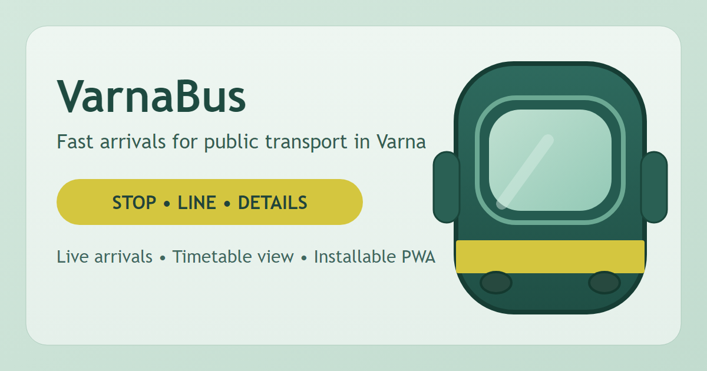

# VarnaBus

**Fast, mobile-first public transport app for Varna, Bulgaria.**

🌐 **Live:** [varnabus.app](https://www.varnabus.app) · installable PWA · BG / EN / UA / RU



> The source code is private. This repository is a public overview of the product and its architecture.
> Source access is available on request for interview purposes.

---

## What it does

- **Real-time arrivals** for every stop, a "Later today" view and full stop timetables
- **Journey Planner:** route alternatives with transfers and walking legs on one shared map, plus an active-journey mode with live stop progress
- **Nearby stops** with walking guidance, favorites and recent stops
- **Route previews** on an interactive map
- **4 languages** (Bulgarian, English, Ukrainian, Russian)
- **Installable PWA**, lightweight and mobile-first, with SEO prerendering

## Tech stack

| Layer | Technology |
|---|---|
| Frontend | React 19, TypeScript, Vite, React Router |
| Maps | Leaflet / react-leaflet |
| i18n | i18next |
| Backend | Cloudflare Workers (Backend-for-Frontend) |
| Testing | Vitest, Testing Library, Playwright (E2E + visual snapshots) |
| Hosting & CI | Vercel, GitHub Actions |

## Architecture (high level)

```
frontend/   React PWA (passenger app)
worker/     Cloudflare Worker Backend-for-Frontend with stable, typed DTOs
shared/     code shared between frontend and worker
docs/       architecture docs and Architecture Decision Records (ADR)
```

The frontend never talks to transport data providers directly. A Backend-for-Frontend combines several data sources into one stable API, so providers can change without touching the UI.

## Quality

- 130+ test files: unit, component, E2E and visual regression
- CI on every push, versioned releases with a changelog and an in-app "What's New"

## About

Built and maintained by **Ivo Nenchev**, front-end developer from Varna, Bulgaria.
Developed with AI-assisted workflows (Claude Code).

[LinkedIn](https://www.linkedin.com/in/ivonenchev)
